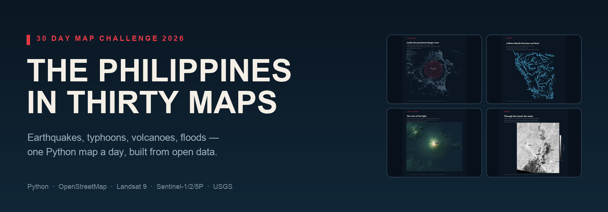
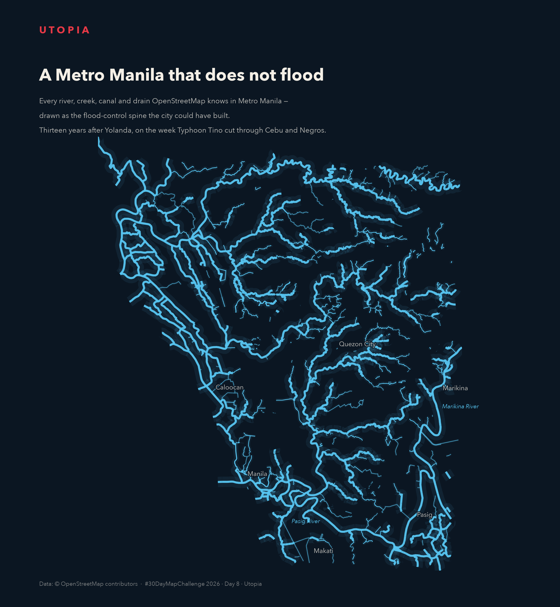
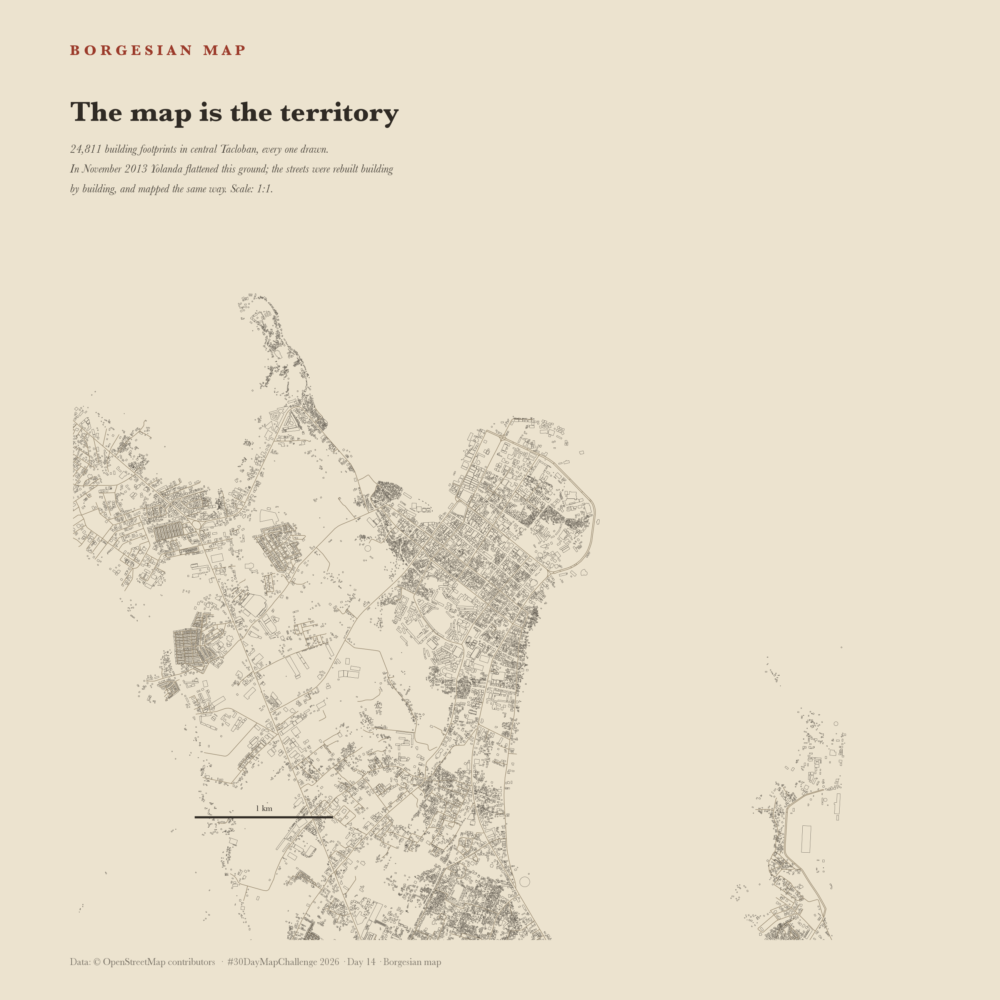
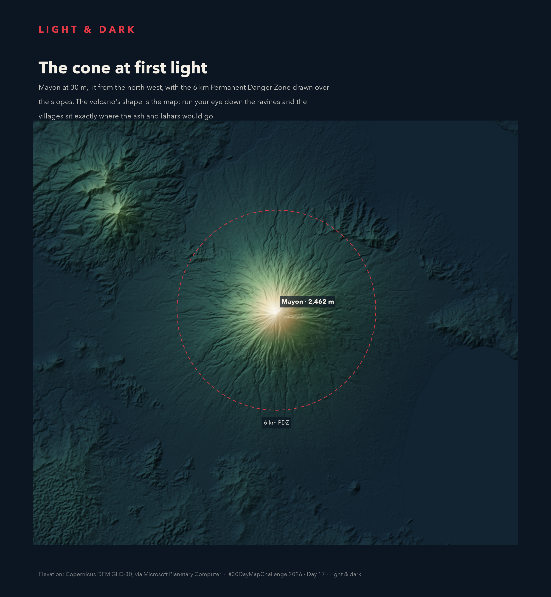
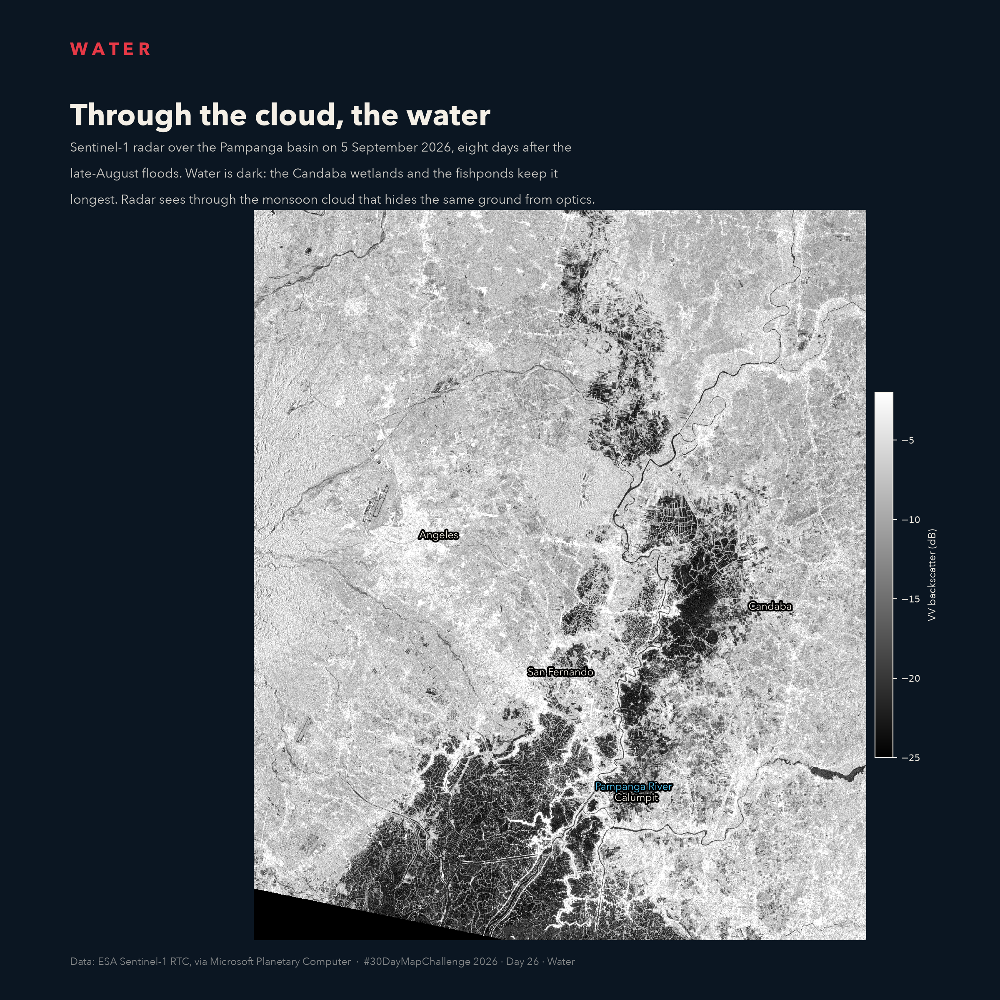
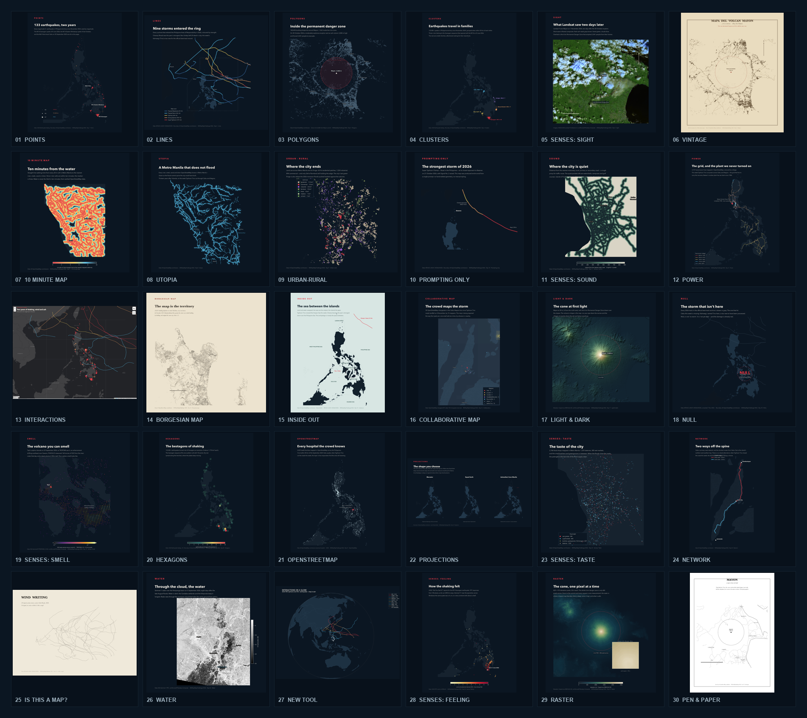

<div align="center">
  
</div>

<h1 align="center">🌏 The Philippines in Thirty Maps</h1>

<p align="center">
  <em>One Python map a day for <a href="https://30daymapchallenge.com/2026">#30DayMapChallenge 2026</a> —<br>
  earthquakes, typhoons, volcanoes, floods, and the people mapping them.</em>
</p>

<p align="center">
  <a href="https://www.lkpanganiban.com/2026-30-day-map-challenge/"></a>
  
  
  
  
  
  
</p>

<p align="center">
  🔗 <b>Live gallery:</b>
  <a href="https://www.lkpanganiban.com/2026-30-day-map-challenge/">www.lkpanganiban.com/2026-30-day-map-challenge</a>
</p>

---

## 🗺️ What is the 30 Day Map Challenge?

The **30 Day Map Challenge** is an annual community mapping project held every
November. It was started in 2019 by Finnish cartographer
[Topi Tjukanov](https://30daymapchallenge.com/) and has grown into one of the
friendliest events in geospatial: thousands of people make one map a day for
thirty days, each following the day's theme, and share it with the hashtag
**#30DayMapChallenge**. There is no sign-up, no judging and no required tool —
only the prompt, the map, and the credit.

The 2026 themes run from the classic **Points, Lines, Polygons** opening to
**Senses: Sight, Sound, Smell, Taste, Feeling**, through **NULL**, **Hexagons**,
**OpenStreetMap**, **Projections**, **Network**, **Water** and **Raster**, and
close with **Pen & paper**. The full list, rules and community galleries live at
[30daymapchallenge.com](https://30daymapchallenge.com/2026), and the official
repository is [tjukanovt/30DayMapChallenge](https://github.com/tjukanovt/30DayMapChallenge).

The rules are deliberately light: you may prepare in advance, late entries are
welcome, and fewer than thirty maps is fine. The spirit is to publish one map on
its themed day, credit your data, and be open about how you made it. The 2026
challenge is sponsored by **Mapbox**.

## 🇵🇭 The idea behind this series

The Philippines has had an extraordinary two years. A magnitude 7.8 earthquake
off Sarangani. Typhoons Bavi, Champi and Tino. Mayon and Taal erupting. Monsoon
floods across Luzon. A power grid stretched by disaster. A food system that runs
through wet markets. A mapping community that keeps editing through the week.

This project uses the thirty prompts as thirty excuses to tell those stories —
with **Python only**, and with **open data**: OpenStreetMap, Landsat 9,
Sentinel-1/2/5P, USGS earthquakes and intensity reports, NOAA's typhoon
best tracks, Copernicus elevation and Natural Earth. Each map asks a question
the data can actually answer, and each README says what it cannot.

I started late, so Days 1–7 are catch-ups published after the fact. Day 7 was
made as a genuine ten-minute build from cached data. Days 8–30 were prepared in advance in a
single late-start sprint. Day 30 is a printable template — the final map is meant to be drawn
by hand.

## ✨ Featured maps

<table>
  <tr>
    <td width="50%" valign="top">
      <a href="day08_utopia/README.md"></a>
      <br><b>Day 08 · Utopia</b><br>
      <sub>Every creek, canal and drain in Metro Manila drawn as the flood-control spine the city could have built — on Yolanda's 13th anniversary.</sub>
    </td>
    <td width="50%" valign="top">
      <a href="day14_borges/README.md"></a>
      <br><b>Day 14 · Borgesian map</b><br>
      <sub>24,811 building footprints in central Tacloban, every one drawn. The map approaches the territory.</sub>
    </td>
  </tr>
  <tr>
    <td width="50%" valign="top">
      <a href="day17_lightdark/README.md"></a>
      <br><b>Day 17 · Light &amp; dark</b><br>
      <sub>Mayon at 30 m, lit from the north-west. The cone's own shadow becomes the map.</sub>
    </td>
    <td width="50%" valign="top">
      <a href="day26_water/README.md"></a>
      <br><b>Day 26 · Water</b><br>
      <sub>Sentinel-1 radar over the Pampanga basin after the August floods — the water the cloud was hiding.</sub>
    </td>
  </tr>
</table>

## 🖼️ All thirty maps

<div align="center">
  <a href="https://www.lkpanganiban.com/2026-30-day-map-challenge/"></a>
  <br>
  <sub>The whole month on one page. <a href="https://www.lkpanganiban.com/2026-30-day-map-challenge/">Open the live gallery</a> — click any map for its story, data and process.</sub>
</div>

## 🧭 How the series was made

Every day followed the same loose method:

1. **Read the prompt twice.** The first idea is usually the obvious one; the
   second is the one that fits the Philippines.
2. **Find the story before the data.** A theme without a story produces a pretty
   but empty map. The recent events — Sarangani, Mayon, Taal, Tino, the August
   floods — supplied the stories.
3. **Choose the simplest geometry that answers the question.** Points for
   epicentres, lines for tracks, polygons for danger zones, hexagons when the
   question is density, raster when the question is a surface.
4. **Fetch once, cache locally.** Every download lands in `data/` and every
   script re-runs offline. Overpass, STAC, USGS and IBTrACS are all cached.
5. **Draw with one visual language.** Dark paper, cream ink, a single red
   accent, Avenir/Arial type and a consistent title block.
6. **Write down the limits.** Each README has a *What this map does not say*
   section. A map that hides its uncertainty is a worse map.
7. **Re-read the rendered image.** Several maps were fixed only after looking at
   the output: a lat/lon axis swap, a flipped land mask, a wrong earthquake
   selected, an inset that hid its own detail.

### What was hard

- **Overpass is fragile.** Public mirrors returned 502s, 429s and connection
  refusals. A proper `User-Agent` fixed the 406s; a local cache fixed the rest.
  Large extracts were split into small, targeted queries.
- **Clouds do not care about deadlines.** Sentinel-2 was 100% cloud over Central
  Luzon during the August floods; the water map moved to Sentinel-1 radar.
- **Archives lag events.** Typhoon Tino was missing from the best-track file
  compiled the week it hit. That absence became Day 18's *NULL*.
- **Open data is uneven.** OSM building and hospital coverage is dense in cities
  and thin elsewhere; the counts are lower bounds, not censuses.
- **Statistics can lie quietly.** A vertically flipped land mask produced a
  wrong "49% of Metro Manila is over ten minutes from water" claim. A finer
  20 m raster exposed it; the corrected figure is 91% within ten minutes.

## 📚 What each day includes

Every folder contains:

| File | What it is |
|---|---|
| `map.py` | The complete, runnable Python script for that day |
| `README.md` | Story, data sources, numbered process, numbers on the map, limits, and a **Data links** section |
| `dayNN_*.png` | The rendered map (or a preview for interactive days) |
| `dayNN_*.html` | An interactive map, where the theme called for one |
| `dayNN_*.pdf` | A printable sheet for Day 30 |

The 30 READMEs total roughly **15,000 words** of documentation.

## 🧪 By the numbers

| | |
|---|---|
| 🗺️ Maps | **30** |
| 🐍 Python scripts | **30** |
| 📖 READMEs | **30** |
| 🖼️ Static PNGs | **30** (including two interactive previews) |
| 🖱️ Interactive maps | **2** (Folium, Plotly) |
| 🖨️ Printable PDF | **1** (A4 tracing sheet) |
| 📡 Data families | **9** (OSM, USGS, NOAA, NASA, ESA, Copernicus, Natural Earth, PHIVOLCS, PAGASA) |
| 🌏 Study area | The Philippines, 4–22°N, 114–128°E |

## 🗂️ Repository layout

```text
30daymapchallenge2026/
├── assets/                  # README banner + 30-map mosaic
├── data/                    # download cache (gitignored)
├── day01_points/
│   ├── map.py
│   ├── README.md
│   └── day01_points.png
├── …
├── day30_penpaper/
│   ├── map.py
│   ├── README.md
│   ├── day30_penpaper.pdf
│   └── day30_penpaper.png
├── index.html               # single-file static gallery
├── build_site.py            # rebuild index.html from the READMEs
├── build_assets.py          # rebuild banner + mosaic
├── osm.py                   # small Overpass fetch helper
├── style.py                 # shared palette, fonts, bounding boxes
└── pyproject.toml
```

## 🚀 Run it

```bash
uv sync
uv run python -m day08_utopia.map       # one map
uv run python build_site.py             # rebuild the gallery
uv run python build_assets.py           # rebuild the README graphics
```

Every download is cached in `data/`, so re-renders are offline and fast. First
runs need network access to Overpass, USGS, IBTrACS, Natural Earth and the
Microsoft Planetary Computer.

## 🌐 Live site & hosting

**Live:** [www.lkpanganiban.com/2026-30-day-map-challenge](https://www.lkpanganiban.com/2026-30-day-map-challenge/)

`index.html` is a single-file, hash-routed gallery: a dashboard of all 30 maps
and a detail view containing each day's rendered README, data links and source
script link. It has no runtime build step.

The site is deployed with GitHub Pages from the `main` branch root; `.nojekyll`
stops Pages from running Jekyll over the map folders. To redeploy after changing
a map or README:

```bash
uv run python build_site.py
git add -A && git commit -m "Update gallery"
git push
```

GitHub Pages rebuilds automatically. To recreate the same setup elsewhere:
push the repository, open **Settings → Pages**, choose **Deploy from a branch**,
and select the branch root (`/`).

Interactive days (`#day13_interactions`, `#day27_newtool`) need network access
for map tiles/Plotly; the static previews are checked in.

## 📡 Data & sources

| Dataset | Source | Used in |
|---|---|---|
| OpenStreetMap | [openstreetmap.org](https://www.openstreetmap.org/copyright) · [Overpass](https://overpass-api.de/) | buildings, roads, waterways, land use, power, hospitals, food, changesets |
| Earthquakes | [USGS FDSN](https://earthquake.usgs.gov/fdsnws/event/1/) | Days 1, 4, 13, 20, 21, 28 |
| Felt reports | [USGS DYFI](https://earthquake.usgs.gov/data/dyfi/) | Day 28 |
| Typhoons | [NOAA/NCEI IBTrACS](https://www.ncei.noaa.gov/products/international-best-track-archive) | Days 2, 10, 13, 15, 18, 25, 27 |
| Landsat 9 | [NASA/USGS](https://www.usgs.gov/landsat-missions/landsat-9) via [Planetary Computer](https://planetarycomputer.microsoft.com/dataset/landsat-c2-l2) | Day 5 |
| Sentinel-1 radar | [ESA Copernicus](https://dataspace.copernicus.eu/) via [Planetary Computer](https://planetarycomputer.microsoft.com/dataset/sentinel-1-rtc) | Day 26 |
| Sentinel-5P SO₂ | [ESA Copernicus](https://dataspace.copernicus.eu/) via [Planetary Computer](https://planetarycomputer.microsoft.com/dataset/sentinel-5p-l2-netcdf) | Day 19 |
| Elevation | [Copernicus DEM GLO-30](https://planetarycomputer.microsoft.com/dataset/cop-dem-glo-30) | Days 17, 29 |
| Land & boundaries | [Natural Earth 1:10m](https://www.naturalearthdata.com/) | basemaps |
| Hazards context | [PHIVOLCS](https://www.phivolcs.dost.gov.ph/) · [PAGASA](https://www.pagasa.dost.gov.ph/) | volcano and typhoon stories |

Every day's README ends with a **Data links** section listing the exact external
sources for that map. The paths under `data/` are local caches, not sources.

## 🧰 Stack

`Python 3.11+` · `uv` · `geopandas` · `shapely` · `osmnx` · `rasterio` ·
`rioxarray` · `pystac-client` · `planetary-computer` · `scipy` · `h3` ·
`networkx` · `folium` · `plotly` · `matplotlib` · `markdown`

## 🗓️ The 30 days

| Day | Theme | Map | Story |
|:---:|---|---|---|
| 01 | 📍 Points | [133 earthquakes, two years](day01_points/README.md) | Sarangani M7.8, Eastern Mindanao M7.4, Cebu M6.9 |
| 02 | 〰️ Lines | [Nine storms entered the ring](day02_lines/README.md) | 2026 PAR tracks; Champi/Rosal strongest, Bavi/Inday 20 dead |
| 03 | ⬡ Polygons | [Inside the permanent danger zone](day03_polygons/README.md) | 1,363 buildings inside Mayon's 6 km PDZ |
| 04 | 🫂 Clusters | [Earthquakes travel in families](day04_clusters/README.md) | 50 km aftershock families of 2025–26 |
| 05 | 👁️ Sight | [What Landsat saw two days later](day05_sight/README.md) | Landsat 9 SWIR of Mayon's ash plume |
| 06 | 📜 Vintage | [Mapa del Volcan Mayon](day06_vintage/README.md) | 19th-century styling; Cagsawa, 1814 |
| 07 | ⏱️ 10 minute map | [Ten minutes from the water](day07_tenmin/README.md) | 20 m walking-time raster to the nearest creek |
| 08 | 🌱 Utopia | [A Metro Manila that does not flood](day08_utopia/README.md) | OSM waterways as a flood-control spine |
| 09 | 🏙️ Urban-rural | [Where the city ends](day09_urbanrural/README.md) | Land use and the farmland at the edge |
| 10 | 🤖 Prompting only | [The strongest storm of 2026](day10_prompting/README.md) | Champi/Rosal at its closest pass to Batanes |
| 11 | 🔊 Sound | [Where the city is quiet](day11_sound/README.md) | Distance from major roads as a noise proxy |
| 12 | ⚡ Power | [The grid, and the plant we never turned on](day12_power/README.md) | Transmission lines; Bataan nuclear plant |
| 13 | 🖱️ Interactions | [Two years of shaking, wind and ash](day13_interactions/README.md) | Interactive Folium map |
| 14 | 🗺️ Borgesian map | [The map is the territory](day14_borges/README.md) | 24,811 buildings in central Tacloban |
| 15 | 🔄 Inside out | [The sea between the islands](day15_insideout/README.md) | Land/water inverted; Tino and Champi |
| 16 | 🤝 Collaborative | [The crowd maps the storm](day16_collaborative/README.md) | 30 OSM changesets since Tino, by mapper |
| 17 | 🌗 Light & dark | [The cone at first light](day17_lightdark/README.md) | Copernicus DEM hillshade of Mayon |
| 18 | 🕳️ NULL | [The storm that isn't here](day18_null/README.md) | Tino missing from the best-track archive |
| 19 | 👃 Smell | [The volcano you can smell](day19_smell/README.md) | TROPOMI SO₂ from Taal |
| 20 | ⬡ Hexagons | [The bestagons of shaking](day20_hexagons/README.md) | H3 bins of M5+ quakes |
| 21 | 🛣️ OpenStreetMap | [Every hospital the crowd knows](day21_osm/README.md) | 2,029 facilities; 16 near the Cebu quake |
| 22 | 🌐 Projections | [The shape you choose](day22_projections/README.md) | Mercator, Equal Earth, azimuthal |
| 23 | 🍽️ Taste | [The taste of the city](day23_taste/README.md) | 2,746 food shops; 385 wet markets |
| 24 | 🕸️ Network | [Two ways off the spine](day24_network/README.md) | Cebu's coastal routes north and south |
| 25 | 🎨 Is this a map? | [Wind writing](day25_art/README.md) | 29 typhoon tracks as ink on paper |
| 26 | 🌊 Water | [Through the cloud, the water](day26_water/README.md) | Sentinel-1 radar of the Pampanga basin |
| 27 | 🧰 New tool | [A globe that turns](day27_newtool/README.md) | Plotly orthographic globe |
| 28 | 💗 Feeling | [How the shaking felt](day28_feeling/README.md) | 597 DYFI responses for the M7.8 |
| 29 | 🔲 Raster | [The cone, one pixel at a time](day29_raster/README.md) | 30 m DEM with a summit pixel zoom |
| 30 | ✍️ Pen & paper | [Mayon, a map to draw by hand](day30_penpaper/README.md) | Printable A4 tracing sheet |

## 🤖 A note on AI

The maps and documentation were built with an AI coding agent (DeepSeek V4.1
Flash in OpenCode) working from the prompts and data in this repository. The
challenge asks participants to be open about how maps are made; this is that
disclosure. Every number, dataset and rendered image was checked against the
cached source data, and the limits sections record where the data cannot support
a claim. The ideas, the story choices and the final editorial calls are human.

## 🙏 Credits

- Challenge: [Topi Tjukanov](https://30daymapchallenge.com/) and the
  #30DayMapChallenge community. 2026 sponsor: **Mapbox**.
- Data: © OpenStreetMap contributors, USGS, NOAA/NCEI, NASA/USGS, ESA Copernicus,
  Natural Earth, PHIVOLCS, PAGASA.
- Every mapper who edited the Philippines in OpenStreetMap — Day 16 is for you.

## 📄 Licence

No single licence is applied to the code in this repository yet. The **data**
remain under their source licences: OSM under ODbL, USGS and NASA under public
domain terms, Copernicus under its open-data terms, IBTrACS under NOAA terms.
Check each README's **Data links** section before reusing a dataset.

<p align="center"><sub>Built with Python, open data, and a lot of cloud checks. 🛰️</sub></p>
